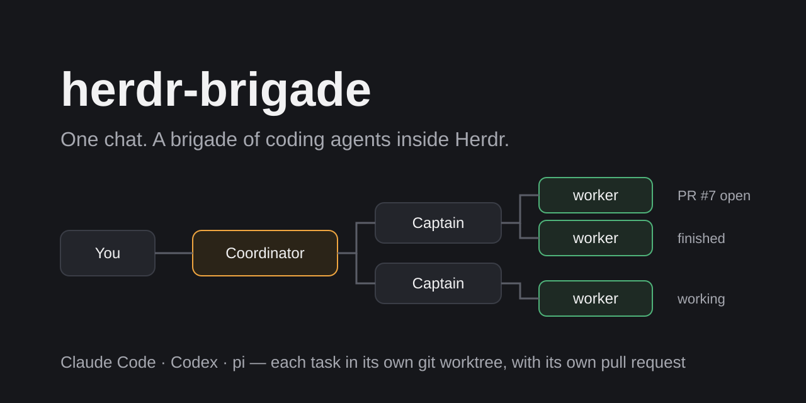
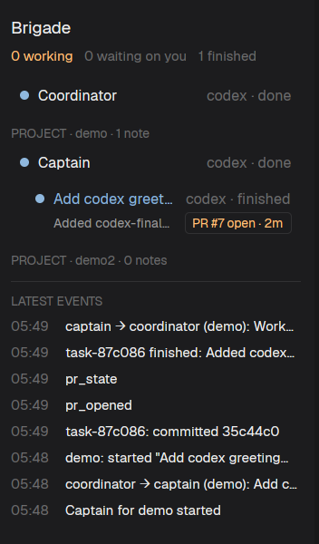

<p align="center">
  
</p>

<h1 align="center">herdr-brigade</h1>

<p align="center">
  One chat. A brigade of coding agents inside Herdr.<br>
  Claude Code, Codex or pi, each task in its own git worktree, with its own pull request.
</p>

You talk to one agent, the **Coordinator**. It sends each request to the **Captain** of the right project. The Captain splits the work into tasks and starts one **worker** per task. Each worker runs in its own Herdr terminal, on its own branch and worktree, commits through brigade, and can open a pull request. A panel in herdr-app shows the whole brigade live.

| Role | One per | Job |
| --- | --- | --- |
| Coordinator | brigade | Takes your requests, adds projects, and sends work to the right Captain. |
| Captain | project | Splits work into tasks, starts and follows up workers, keeps the project's notes, reports back. |
| Worker | task | Does the work in its own worktree, commits, opens a pull request, and reports when done or blocked. |

Each role can run on Claude Code, Codex or pi, with its own model, effort and permission level.

<p align="center">
  
</p>

## How to use

### Requirements

- Linux with **Herdr**: the `hc` core and the `herdr-app` window. Tested with hc 0.1.19 and herdr-app 0.1.14.
- **Node 22.23.3** (pinned; `mise install` gets it).
- At least one agent CLI, signed in: **Claude Code** (tested 2.1.319), **Codex** (0.167.0) or **pi** (1.5.0).
- **git**, and the **GitHub CLI** (`gh`, signed in) if workers should open pull requests.

### Install

```sh
git clone https://github.com/smkamranqadri/herdr-brigade.git && cd herdr-brigade
mise install && npm ci
npm run brigade -- init          # writes ~/.config/herdr-brigade/config.json
npm run brigade -- mod install   # installs the Brigade panel into herdr-app
```

`init` writes a starter config: the Coordinator on Claude Code (`claude-opus-5-5`), Captains and workers on `claude-sonnet-5-5`. Change any role in the file. To open the panel from a button beside Automations, see [docs/herdr-app.md](docs/herdr-app.md). `npm run brigade -- panel` opens it as a window instead.

### First steps

1. Start the brigade: click **Start brigade** in the panel, or run `npm run brigade -- start`. The Coordinator opens over your current tab.
2. Add a project by chat: *"add my repo shop-site as a project"*. Brigade looks for the repo under `~/Repositories` (set `repoRoots` to change that). If the repo's `origin` is on GitHub, that repo is pinned, and pull requests go only there.
3. Ask for work: *"in shop-site, add a dark mode toggle and open a pull request"*. The Captain starts a worker and reports back when it finishes or needs you.
4. Click any row in the panel to open that agent over your tab and talk to it. **↗ keep** makes it a tab.

Project notes are lasting preferences, such as *"remember for shop-site: designs use little text"*. Every new worker of that project starts with them. Workers can suggest notes; the Captain accepts, merges or rejects each one.

### Commands

| Command | What it does |
| --- | --- |
| `npm run brigade -- init` | Write a starter config (never overwrites one). |
| `npm run brigade -- start` | Start the Coordinator, or show it if it is running. |
| `npm run brigade -- status` | List the brigade's agents and tasks. |
| `npm run brigade -- panel` | Open or close the Brigade panel as a window. |
| `npm run brigade -- mod install` | Install or update the panel in herdr-app. |

### Configuration

`~/.config/herdr-brigade/config.json`:

```json
{
  "owner": "Sam",
  "repoRoots": ["/home/sam/Repositories"],
  "roles": {
    "coordinator": { "harness": "claude", "model": "claude-opus-5-5", "effort": "medium" },
    "captain": { "harness": "claude", "model": "claude-sonnet-5-5", "effort": "low" },
    "worker": { "harness": "codex", "model": "gpt-6.1-terra", "effort": "medium", "permissions": "auto" }
  },
  "projects": [
    { "name": "shop-site", "repo": "/home/sam/Repositories/shop-site", "baseBranch": "main", "github": "sam/shop-site" }
  ]
}
```

- `harness`: `claude`, `codex` or `pi`. `effort`: `low`, `medium`, `high`, `xhigh` or `max`.
- `permissions`: `ask`, `auto` (the worker default) or `bypass`. The Coordinator and Captains never get shell or file-edit tools, whatever their level. A Codex worker runs in Codex's sandbox unless it is on `bypass`.
- `repoRoots`: absolute paths where brigade looks for repos (default `~/Repositories`).
- Projects are usually added by chat. Agents can add projects and change a base branch, but they can't change `owner`, `roles`, `repoRoots` or a project's GitHub repo.
- Environment variables (all optional) are listed in [.env.example](.env.example).

## What you get

- **One chat for every project.** The Coordinator routes work and reports results, so you don't juggle terminals.
- **Isolated tasks.** Each worker gets its own branch and git worktree, so parallel tasks don't collide.
- **Commits that work in any sandbox.** Workers commit through brigade, which first checks that the worktree, repo and branch are still the task's own.
- **Pull requests, pinned.** A worker pushes only its own branch, only to the project's pinned GitHub repo, never with force, and never to a merged or closed PR's branch. `list_tasks` reads each PR's live state from GitHub.
- **Project notes with a retro.** Lasting preferences reach every new worker, within a budget. The Captain settles workers' suggestions.
- **A live panel.** Agents, tasks, PR chips, note counts and the latest events, with a Start button and click-to-open.
- **Mix harnesses.** Any role on Claude Code, Codex or pi.

## Contributing

See [CONTRIBUTING.md](CONTRIBUTING.md). In short: `npm run gate` must pass, every change comes with its test, and every guard is checked by breaking it.

## Security

Agents run as your user and act on your repos. Read [SECURITY.md](SECURITY.md) for what brigade guards, what it doesn't, and how to report a problem.

## Project layout

```text
src/domain/        rules with no I/O: config, tasks, notes, pull requests
src/application/   use cases: Coordinator, Captain and worker tools, publishing, notes
src/adapters/      hc, git, gh, the harness launchers (Claude Code, Codex, pi), the MCP server, files
src/entrypoints/   the brigade CLI and its wiring
prompts/           each role's system prompt
mod/               the Brigade panel for herdr-app
pi-extension/      registers brigade's MCP server in pi
scripts/           the gate's helpers and the real-agent run (scripts/e2e.sh)
docs/              architecture, decisions, plans, real-agent runs, reviews
poc/               the first proof of concept (see docs/poc.md)
```

## Credits

The design follows [Box Yard](https://github.com/AgentSystemLabs/box-yard): a Coordinator, a Captain per project and a worker per task. The code is written from scratch for Herdr.

## License

[MIT](LICENSE)
